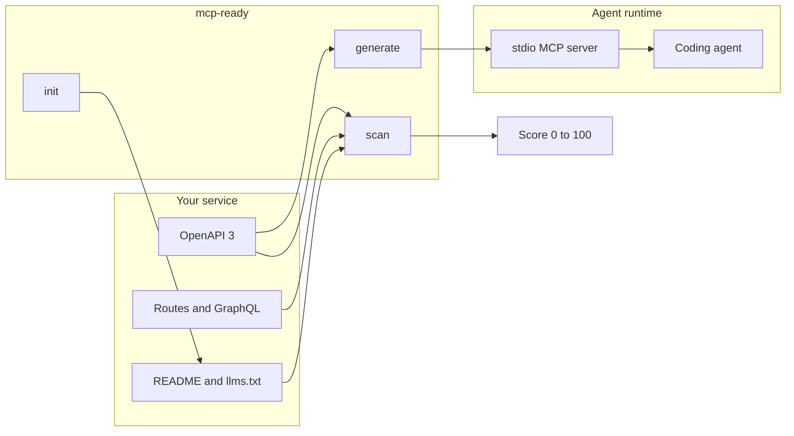
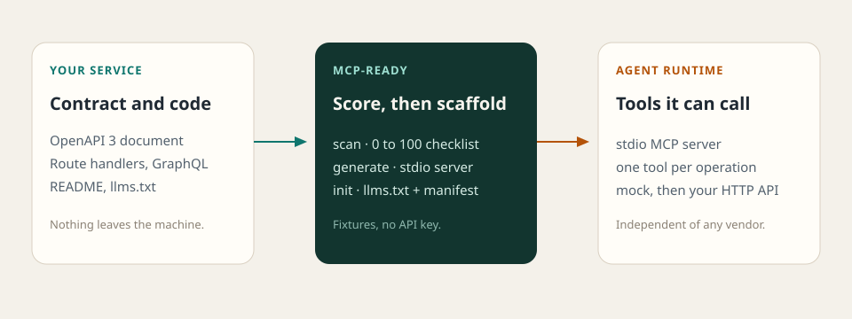

# mcp-ready

[](https://github.com/tz0127302-cell/mcp-ready/actions/workflows/ci.yml)
[](https://github.com/tz0127302-cell/mcp-ready/blob/main/LICENSE)
[](https://github.com/tz0127302-cell/mcp-ready/blob/main/package.json)
[](https://github.com/tz0127302-cell/mcp-ready/blob/main/tsconfig.json)

Agents are already routing work to the services they can call.
If a product has no API and no MCP server, those workflows skip it and use whatever answers.

mcp-ready scores that gap from 0 to 100 and scaffolds a stdio MCP server that runs on fixtures, with no API key and no network.

> mcp-ready is an independent open-source tool. It is not affiliated with, endorsed by, or maintained by Anthropic or the Model Context Protocol governance bodies.

## Try the sample

mcp-ready is not published to npm. Clone the repository and install dependencies in the working tree. Do not run `npm install mcp-ready`.

```bash
git clone https://github.com/tz0127302-cell/mcp-ready.git
cd mcp-ready
npm install
npm run mcp-ready -- scan examples/orders-catalog
```

That command is offline. It reads the orders and catalog OpenAPI file, plus the router, GraphQL schema, and README beside it.

```text
mcp-ready 0.1.0

Orders & Catalog API
OpenAPI 3.0.3 · v1.4.0 · 8 operations
examples/orders-catalog/openapi.yaml

Score  65/100   Ready with gaps
█████████████████████░░░░░░░░░░░

Checklist
  PARTIAL  Auth story            10/12
           Auth is partly documented.
  PARTIAL  Structured errors      9/12
           Error bodies are incomplete.
  PARTIAL  Idempotency            3/10
           1 of 3 mutating operations is safe to retry.
  PASS     Pagination            10/10
           Collection endpoints expose a cursor and a next field.
  FAIL     Webhooks                0/8
           No webhooks or callbacks.
  PARTIAL  Well-typed schemas    12/14
           6 of 8 operations are well typed.
  PARTIAL  Tool-sized endpoints  10/12
           1 operation is too vague or too wide to be a tool.
  PASS     Rate-limit docs       10/10
           Agents can see when to slow down.
  PARTIAL  Agent-facing docs      1/12
           Agent-facing docs are incomplete.

Signals
  llms.txt no   missing
  manifest no   missing
  skill    no   missing
  routes     7 handler(s) · graphql 2 queries / 1 mutations / 1 subscriptions

Top fixes
  1. Add llms.txt so agents can discover this API without scraping HTML.
     mcp-ready init writes a starter.
  2. Add mcp.manifest.json with the server command and tool list. mcp-ready
     init writes one.
  3. Add AGENTS.md that says when to read and when to call a mutating tool.
     mcp-ready init writes a starter.
  4. Declare OpenAPI webhooks for events an agent would otherwise poll for.
  5. Add an Idempotency-Key header on POST /orders/{orderId}/cancel, POST
     /admin/execute. Agents retry creates.
  6. Add a structured error response on GET /health, POST
     /orders/{orderId}/cancel, POST /admin/execute.
```

The sample is deliberately unfinished. Pagination and rate limits pass. Webhooks, idempotent cancels, and agent-facing docs do not. `POST /admin/execute` is a catch-all and is called out as a bad tool.

```bash
npm run mcp-ready -- scan examples/orders-catalog --json
npm run mcp-ready -- scan examples/orders-catalog --markdown --out readiness.md
npm run mcp-ready -- scan examples/orders-catalog --fail-under 70
```

`--fail-under` exits 2 when the score is too low, which is the useful one in CI. `--json` prints a single JSON document on stdout.

## What the score is looking at





An agent does not want a 200-page reference. It wants a credential story, a schema, a way to turn the page, a way to retry a create, and a sentence that says what the tool does. The checklist is those requirements, weighted.

| Check | Points | What "pass" means |
| --- | ---: | --- |
| Auth story | 12 | Security schemes are applied or the API is explicitly public, with 401 and 403 responses. |
| Structured errors | 12 | Operations return a shared problem schema, ideally `application/problem+json`. |
| Idempotency | 10 | POST and PATCH send an `Idempotency-Key`, or the method is idempotent by HTTP. |
| Pagination | 10 | Collection GETs take a cursor and return `nextCursor` (or equivalent). |
| Webhooks | 8 | OpenAPI `webhooks` or callbacks carry a typed payload. |
| Well-typed schemas | 14 | Success bodies and write bodies are objects with properties, not bare maps. |
| Tool-sized endpoints | 12 | Each operation has an `operationId`, a sentence of description, and one action. Catch-alls and `execute` bags lose points. |
| Rate-limit docs | 10 | A 429 response, rate-limit or `Retry-After` headers, and a sentence in the description. |
| Agent-facing docs | 12 | `llms.txt` (5), `mcp.manifest.json` (3), `AGENTS.md` or `SKILL.md` (2), and descriptions on at least 80% of operations (2). |

The nine checks sum to 100.

| Score | Grade |
| --- | --- |
| 90–100 | Agent-ready |
| 75–89 | Nearly ready |
| 55–74 | Ready with gaps |
| 30–54 | At risk |
| 0–29 | Not agent-ready |

A concern that does not apply still passes. A read-only API with no POST gets full idempotency marks. An API with no list endpoint gets full pagination marks. An empty tree scores 0.

Without an OpenAPI document the same checks run on source heuristics and are capped (auth 6, errors 6, schemas 6, tool shape 8, and so on). A careful source tree tops out at 53, which is still "At risk". Publish a contract. GraphQL schemas are read for query, mutation, and subscription fields and scored as candidate tools, with the same advice: one MCP tool per field, not a single `POST /graphql` proxy.

`test/fixtures/agent-ready` is the fixture that scores 100. If you change a check, keep that fixture green and update this table.

## Generate a server

```bash
npm run mcp-ready -- generate \
  --spec examples/orders-catalog/openapi.yaml \
  --out ./orders-mcp
cd orders-mcp
npm install
npm start
```

`generate` maps operations to tools and skips deprecated operations, catch-all paths, and generic actions such as `POST /admin/execute`. The process speaks MCP on stdin and stdout. Mock mode is the default: tools return the examples from the spec and do not call the network. Startup does not read a token.

`create_order` comes out like this:

```ts
server.registerTool(
  "create_order",
  {
    title: "Create an order",
    description:
      "Place an order for a single SKU. Send an Idempotency-Key and reuse it when you retry so the same attempt does not create two orders. (POST /orders). Mock mode returns fixture data and does not send credentials.",
    inputSchema: z.object({
      idempotencyKey: z.string().min(8).max(128).describe("Unique key for this create attempt. Replays with the same key and the same body return the original order."),
      sku: z.string().describe("Catalog SKU to purchase."),
      quantity: z.number().int().min(1).describe("Number of units."),
      customerNote: z.string().describe("Optional note for the packer.").optional(),
    }),
    annotations: {
      readOnlyHint: false,
      destructiveHint: false,
      idempotentHint: true,
      openWorldHint: true,
    },
  },
  async (args) => {
    const result = await execute("createOrder", args);
    return { content: [{ type: "text", text: JSON.stringify(result, null, 2) }] };
  },
);
```

The real file also wraps the handler so a thrown error becomes an MCP tool error. Point it at a live API only when you mean to:

```bash
export MCP_READY_MOCK=0
export API_BASE_URL=https://api.example.com
export API_TOKEN=...   # sent as Authorization: Bearer, and only when a tool is called
npm start
```

`API_KEY`, when set, is sent as `X-Api-Key`. Neither value is written into the generated files.

## Init agent docs

```bash
npm run mcp-ready -- init examples/orders-catalog
```

Copy the folder first if you want the checked-in demo to keep scoring 65. The command writes three files, and leaves any of them that already exist unless you pass `--force`:

- `llms.txt` — a short index in the [llms.txt](https://llmstxt.org/) shape
- `mcp.manifest.json` — an unofficial starter manifest (name, stdio command, suggested tools)
- `AGENTS.md` — when to read, when to write, and how to retry

The manifest is not a registry record. It is a hint you can edit.

## Commands

```text
mcp-ready scan <path> [--json] [--markdown] [--out file] [--fail-under n] [--no-color] [--ascii]
mcp-ready generate --spec <openapi> --out <dir> [--name n] [--max-tools n] [--force]
mcp-ready init [path] [--name n] [--url u] [--description text] [--force]
mcp-ready --help
mcp-ready --version
```

`scan` accepts an OpenAPI 3 YAML or JSON file, or a directory. A file is scored together with docs sitting next to it. A directory is walked (skipping `node_modules`, `dist`, and similar) for OpenAPI, GraphQL, route handlers (Express-style, Nest, and Next.js), `llms.txt`, `mcp.manifest.json`, and `AGENTS.md`. Swagger 2.0 is converted best-effort and flagged.

Exit codes: `0` success, `1` usage or a bad spec, `2` score below `--fail-under`.

## Library

```ts
import { writeFile } from "node:fs/promises";
import { generateServer, initProject, renderMarkdown, scan } from "mcp-ready";

const report = await scan("openapi.yaml");
await writeFile("readiness.md", renderMarkdown(report));

await generateServer({
  specPath: "openapi.yaml",
  outDir: "./mcp-server",
});

await initProject({ target: ".", name: "Orders API" });
```

`scan` returns the same object `--json` prints: `score`, `grade`, `checks[]` with findings and recommendations, and `discovery`. The `mcp-ready` import above is the local package entry, not a registry package. From a clone, run `npm run build` and point Node at this repo (`npm link`, or a `file:` dependency) before importing it.

## What this is not

mcp-ready does not proxy traffic, host a server, or audit you for vulnerabilities. A high score means an agent can tell what to call. It does not mean the service is safe. The scanner does not upload the spec. See [SECURITY.md](SECURITY.md).

## Development

Node.js 20 or newer. [CI](https://github.com/tz0127302-cell/mcp-ready/actions/workflows/ci.yml) runs the suite on Node 20 and 22. Issues and pull requests: https://github.com/tz0127302-cell/mcp-ready/issues

```bash
git clone https://github.com/tz0127302-cell/mcp-ready.git
cd mcp-ready
npm install
npm test
npm run typecheck
npm run build
node dist/cli.js scan examples/orders-catalog --fail-under 40
```

See [CONTRIBUTING.md](CONTRIBUTING.md). The changelog is in [CHANGELOG.md](CHANGELOG.md).

## License

[MIT](LICENSE)
